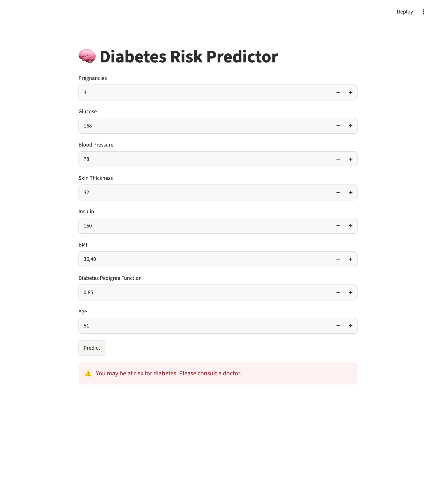
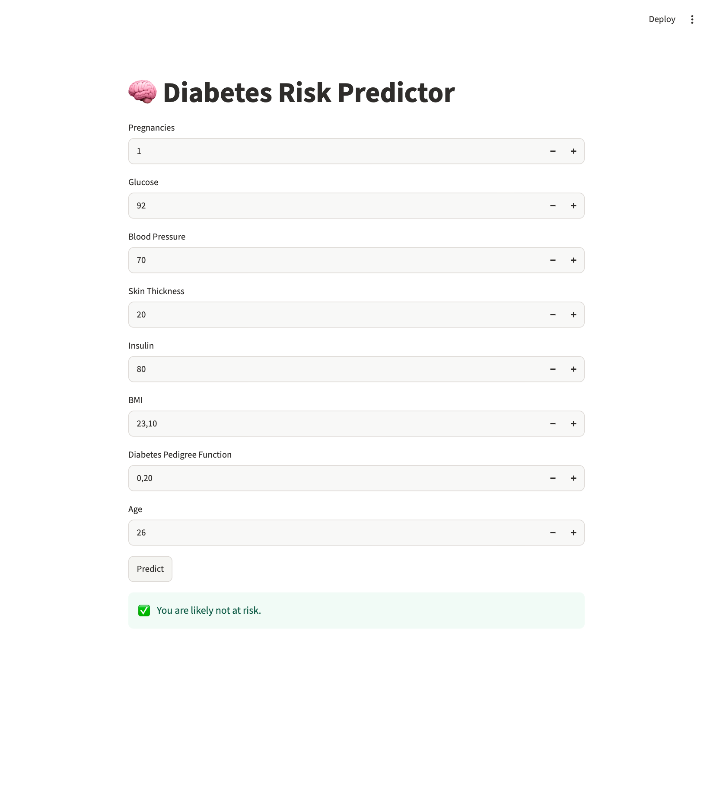

# Diabetes Risk Predictor

This app uses a machine learning model to predict the likelihood of a person having diabetes based on medical inputs.

## Demo

The running app after `python model.py` and `streamlit run app.py`, with two example patients.

| higher-risk profile | lower-risk profile |
|---|---|
|  |  |

## How to Use

1. Install the dependencies:
   ```
   pip install -r requirements.txt
   ```

2. Train the model:
   ```
   python model.py
   ```

3. Run the app:
   ```
   streamlit run app.py
   ```
Dataset used: [Pima Indians Diabetes Database]